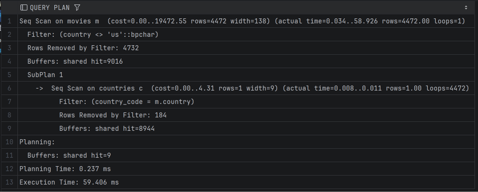
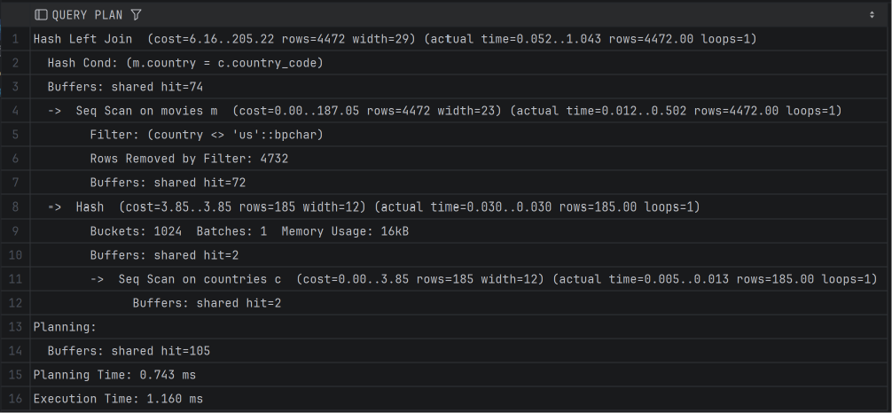
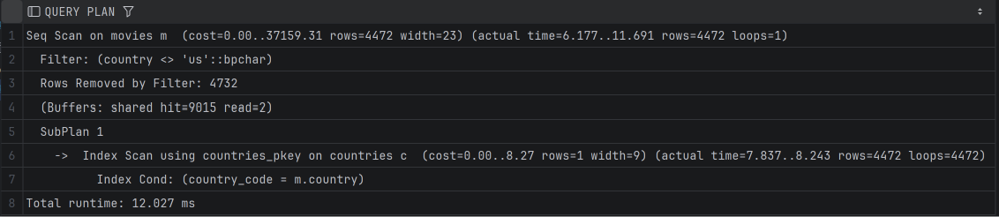
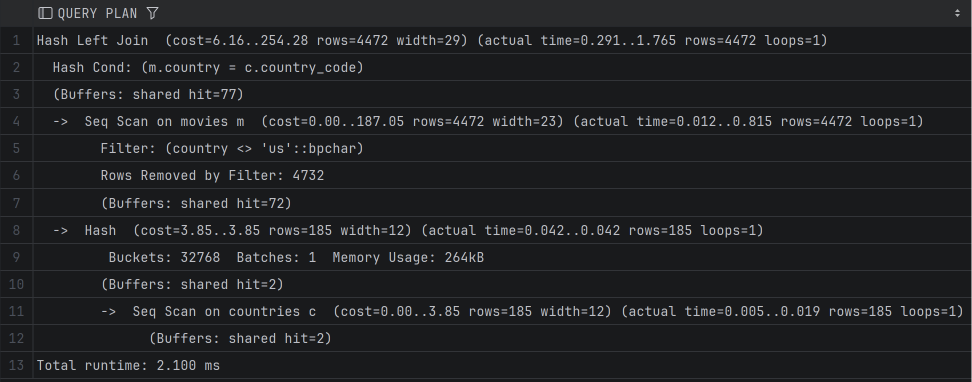
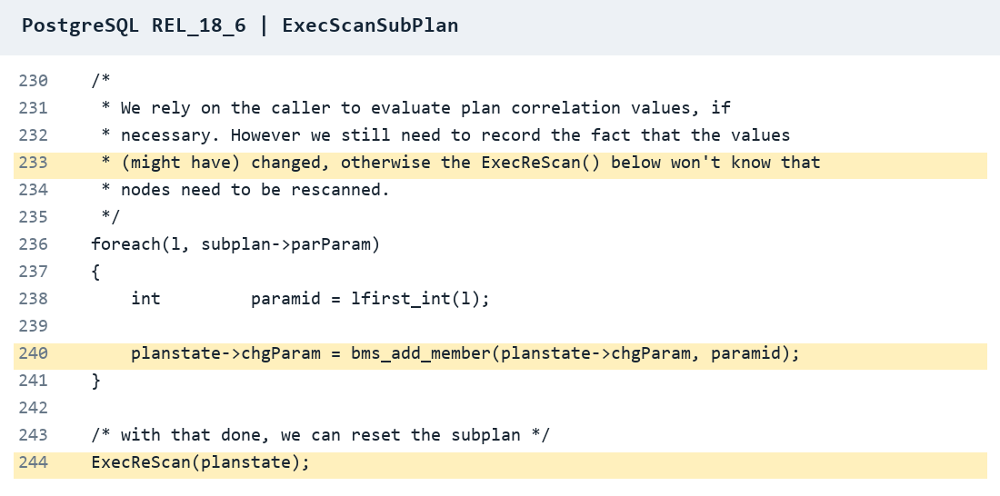
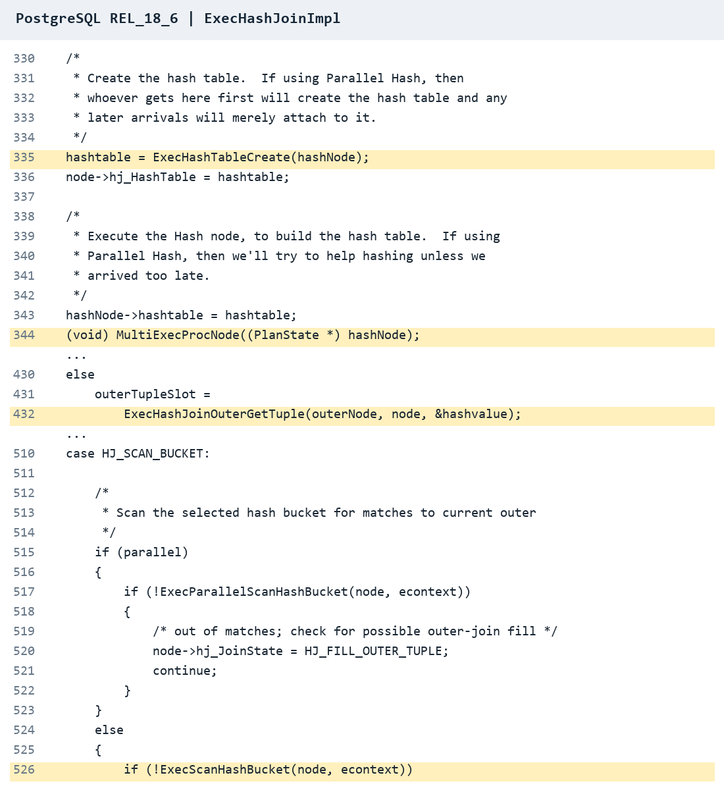
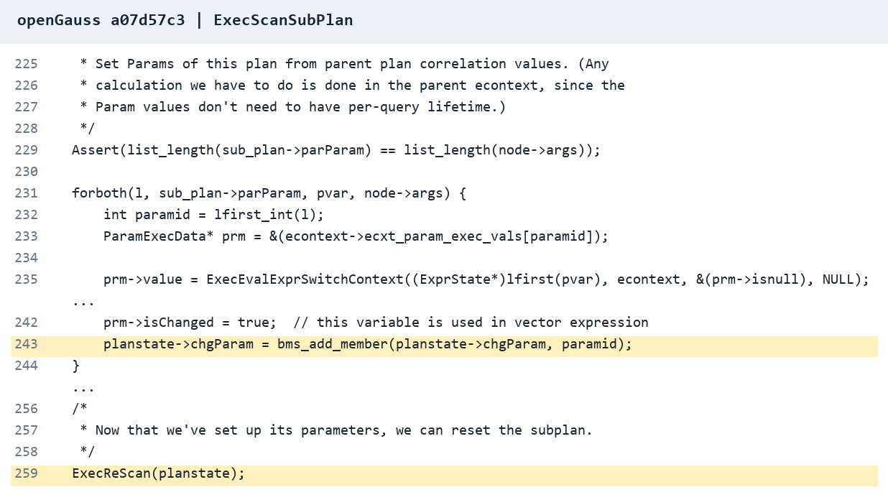
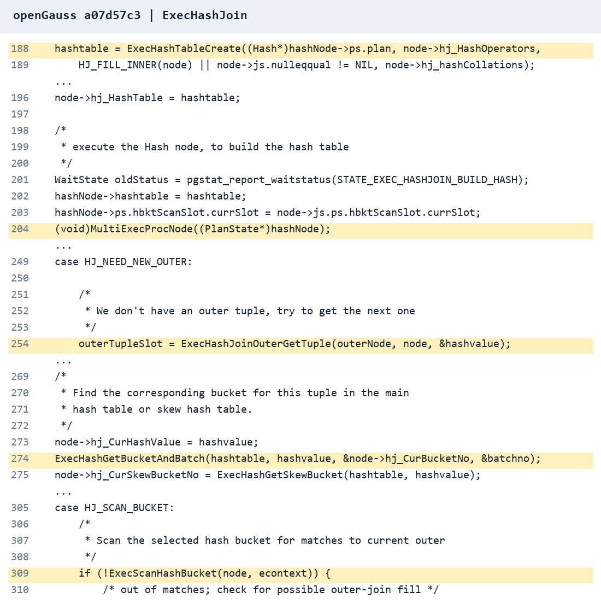

# Assignment 2 实验报告
https://github.com/Tiezhiii715/sophomore/tree/main/database/Assignment2#readme

## Scalar Subquery 与 LEFT JOIN 的性能比较

## 1 目的

本实验在 PostgreSQL 和 openGauss 中比较标量子查询与 LEFT JOIN 两种写法。通过重复计时和实际执行计划，观察查询是否保留相关子计划、子计划执行次数以及连接方法，解释性能差异。

## 2 环境

| 项目 | PostgreSQL | openGauss |
| --- | --- | --- |
| 数据库版本 | PostgreSQL 18.6 | openGauss 5.0.0，build a07d57c3 |
| movies 行数 | 9,024 | 9,024 |
| countries 行数 | 185 | 185 |
| country <> 'us' 的电影数 | 4,472 | 4,472 |

## 3 查询与结果

### 3.1 五次正式测量

Query A 使用相关标量子查询：

```sql
SELECT m.title,
       m.year_released,
       (SELECT c.country_name
        FROM countries AS c
        WHERE c.country_code = m.country) AS country_name
FROM movies AS m
WHERE m.country <> 'us';
```

Query B 使用 LEFT JOIN：

```sql
SELECT m.title,
       m.year_released,
       c.country_name
FROM movies AS m
LEFT JOIN countries AS c
  ON c.country_code = m.country
WHERE m.country <> 'us';
```

在每个系统中，先对 A、B 各运行一次进行预热，然后交替运行 A、B，各记录五次正式耗时。预热不计入五次结果。

结果如下，单位均为毫秒（ms）：

| 系统 | 查询 | 第1次 | 第2次 | 第3次 | 第4次 | 第5次 | 平均值 | 中位数 |
| --- | --- | ---: | ---: | ---: | ---: | ---: | ---: | ---: |
| PostgreSQL | A | 462 | 423 | 430 | 396 | 413 | 424.8 | 423 |
| PostgreSQL | B | 371 | 369 | 385 | 380 | 423 | 385.6 | 380 |
| openGauss | A | 399 | 380 | 383 | 485 | 422 | 413.8 | 399 |
| openGauss | B | 370 | 438 | 408 | 441 | 423 | 416.0 | 423 |

PostgreSQL 中，B 的平均耗时比 A 低约 9.23%，五组对应测量中有四组 B 更低。openGauss 中，B 的平均耗时比 A 高约 0.53%，两种查询的测量区间明显重叠，此五次结果没有显示 B 具有稳定优势。

### 3.2 实际执行计划中的耗时

四份实际执行计划分别见第 4.1–4.4 节的图 1–4。

| 系统 | A 的数据库执行时间 | B 的数据库执行时间 | 本次计划采样中 A/B 耗时比 |
| --- | ---: | ---: | ---: |
| PostgreSQL | 59.406 ms | 1.160 ms | 约 51.21 |
| openGauss | 12.027 ms | 2.100 ms | 约 5.73 |

两组时间测的是不同过程。第 3.1 节的 369–485 ms 是运行查询时客户端显示的时间；这里的时间来自执行计划。一次查询通常要经过“发送请求、数据库计算、传回结果、客户端显示”。数据库计算可能很快，但传输和显示也需要时间，所以 B 在数据库里执行更快，客户端显示的总耗时却可能和 A 差不多。

PostgreSQL 有 Planning Time 和 Execution Time。上表为后者，不包含前者（A 为 0.237 ms，B 为 0.743 ms），openGauss 显示的是 Total runtime。
另外，EXPLAIN ANALYZE 返回执行计划，本身也有统计开销，两种计时不能直接等同。**本次计划采样显示，两套系统中都是 B 执行更快。**

## 4 执行计划分析

### 4.1 PostgreSQL：A 保留子计划，重复顺序扫描国家表



*图 1 PostgreSQL Query A*

该计划明确保留 SubPlan 1，**没有把 A 改写成连接**。

也就是：

1. 扫描 movies，筛出 4,472 部非美国电影。
2. 取其中一部电影的 country，比如 'cn'。
3. 扫描 countries 的 185 行，找出代码为 'cn' 的国家名称。
4. 对下一部电影重复这个过程，即使它也是 'cn'，仍会再扫描一次。

按本次数据，可理解为约 4,472 × 185 = 827,320 次国家记录检查。
子计划的 shared hit=8944 表示累计缓冲区命中次数。预热后的缓存命中没有消除重复执行子计划本身的开销。

### 4.2 PostgreSQL：B 构建一次哈希表，再匹配电影



*图 2 PostgreSQL Query B*

B 扫描一次 countries，将 185 条记录建立为哈希表，再用筛选后的电影国家代码进行匹配。它**避免了为每部电影再次扫描** countries。

A 和 B 都输出 4,472 行，但 **A 的国家表被重复扫描 4,472 次，B 的国家表只扫描一次**。这是本次计划中 B 更快的直接解释。A、B 的执行阶段 shared hit 分别为 9,016、74，也与重复访问和一次构建的区别一致。

### 4.3 openGauss：A 保留子计划，但使用主键索引



*图 3 openGauss Query A*

openGauss 同样保留 SubPlan 1，且 loops=4472，因此 A **没有在本次计划中被改成一个连接**。

与 PostgreSQL 本次计划不同，它通过 countries_pkey 索引查找对应国家，而不是反复顺序扫描整个国家表。
索引减少了每次查找需要检查的数据，但仍存在 4,472 次子计划调用和索引访问。

A 还记录了 shared read=2，说明该次计划采样存在少量缓冲区读取。仅凭这一次记录，不能把两系统 A 的全部耗时差异归因于索引，也不能把它解释成纯缓存内测试。

### 4.4 openGauss：B 同样采用 Hash Left Join



*图 4 openGauss Query B*

B 同样只扫描一次国家表，构建哈希表后连接电影记录，输出 4,472 行。与 A 的重复索引查找相比，B 避免了逐电影调用国家子计划，查找的步骤和开销不同，本次 B 执行更快。

## 5 对应版本的源码分析

以下每个系统选两个关键函数，将源码行为与实际执行计划对应。

### 5.1 PostgreSQL 18.6

**A：`ExecScanSubPlan`，处理需要重新执行的子计划。**

源码：[nodeSubplan.c，第 230–244 行](https://github.com/postgres/postgres/blob/REL_18_6/src/backend/executor/nodeSubplan.c#L230-L244)。函数从第 204 行开始。

代码遍历关联参数 `parParam`，通过 `chgParam` 标记参数可能发生变化，随后调用 `ExecReScan(planstate)` 重置子计划。（重新执行子计划，不等于必然全表扫描。这里 PostgreSQL 的子计划恰好是 `Seq Scan on countries`，因此每部电影都会重新扫描国家表。）

这解释了为什么 A 的国家子计划会执行 4,472 次。



*图 5 PostgreSQL 子计划参数标记与重置*

**B：`ExecHashJoinImpl`，先建哈希表，再逐行查找匹配。**

源码：[nodeHashjoin.c，建立哈希表部分，第 330–344 行](https://github.com/postgres/postgres/blob/REL_18_6/src/backend/executor/nodeHashjoin.c#L330-L344)；[读取外层记录，第 421–432 行](https://github.com/postgres/postgres/blob/REL_18_6/src/backend/executor/nodeHashjoin.c#L421-L432)；[匹配哈希桶，第 510–526 行](https://github.com/postgres/postgres/blob/REL_18_6/src/backend/executor/nodeHashjoin.c#L510-L526)。

函数在构建阶段调用 `ExecHashTableCreate` 创建哈希表，再通过 `MultiExecProcNode` 执行 Hash 节点、填入数据。接着取下一条外层记录，在对应哈希桶中检查匹配项。

这与图 2 中国家表只扫描一次、电影输出 4,472 行的计划一致。B 仍需对每部电影进行查找，但不再为每部电影重新调用国家子计划。



*图 6 创建哈希表、读取电影及查找匹配*

### 5.2 openGauss 5.0.0 build a07d57c3

**A：`ExecScanSubPlan`，设置当前电影的参数后重新执行子计划。**

源码：[nodeSubplan.cpp，第 225–259 行](https://github.com/opengauss-mirror/openGauss-server/blob/a07d57c3/src/gausskernel/runtime/executor/nodeSubplan.cpp#L225-L259)。函数从第 204 行开始。

代码通过 `ExecEvalExprSwitchContext` 取得外层关联参数，将其写入 `prm->value`（第 235 行），再标记参数变化并调用 `ExecReScan(planstate)`。
这对应“取当前电影的国家代码，再执行一次国家查询”。

openGauss 的 A 在这次计划中使用 `Index Scan using countries_pkey`。因此重新执行的是索引查找，不是反复扫描全部 185 个国家。索引已经存在，不会在每次子查询中重建；重复发生的是子计划调用和索引查找。



*图 7 获取关联参数、标记变化并重置子计划*

**B：`ExecHashJoin`，构建哈希表后按电影逐条匹配。**

源码：[nodeHashjoin.cpp，建立哈希表部分，第 188–205 行](https://github.com/opengauss-mirror/openGauss-server/blob/a07d57c3/src/gausskernel/runtime/executor/nodeHashjoin.cpp#L188-L205)；[读取电影及定位哈希桶，第 249–275 行](https://github.com/opengauss-mirror/openGauss-server/blob/a07d57c3/src/gausskernel/runtime/executor/nodeHashjoin.cpp#L249-L275)；[检查匹配，第 305–310 行](https://github.com/opengauss-mirror/openGauss-server/blob/a07d57c3/src/gausskernel/runtime/executor/nodeHashjoin.cpp#L305-L310)。

先创建哈希表并执行 Hash 节点填入国家数据，之后通过 `ExecHashJoinOuterGetTuple` 取得下一部电影，根据哈希值确定桶，再用 `ExecScanHashBucket` 检查匹配项。与图 4 的 Hash Left Join、国家表 `loops=1` 一致。

A、B 都要逐部电影查找国家，但使用的方式不同：A 每次调用子查询并走主键索引，B 在本次查询中建好哈希表后进行匹配。因此“都查找 4,472 次”并不意味着耗时相同。
B 的总执行时间为 2.100 ms，低于 A 的 12.027 ms，说明本次采用哈希连接的整体开销更小，但不能据此认定所有数据规模下 B 都更快。



*图 8 创建哈希表、取得电影及匹配哈希桶*

## 6 结论

在本次数据和实际执行计划中，两套系统 **Query A 保留了相关子计划**，并执行 4,472 次；Query B 采用 Hash Left Join，国家表只扫描一次。PostgreSQL 的 A 重复顺序扫描 countries，openGauss 的 A 则重复使用 countries_pkey 索引查找。

单次 EXPLAIN ANALYZE 结果显示，B 在两套系统中的数据库执行阶段均更快，PostgreSQL 中的差异尤其明显。就当前查询、数据规模和已观察到的计划而言，我**倾向使用 Query B**，因为它避免了大量重复子计划调用，并且直接表达了保留电影记录、补充国家信息的需求。

不过，五次客户端计时中，openGauss 的 A、B 平均耗时接近，B 在数据库执行阶段的优势没有明显体现在客户端计时中。
