# Lab8报告

[GitHub 在线报告](https://github.com/Tiezhiii715/sophomore/blob/main/database/Lab8/Lab8_Report.md)

## E1 原子性

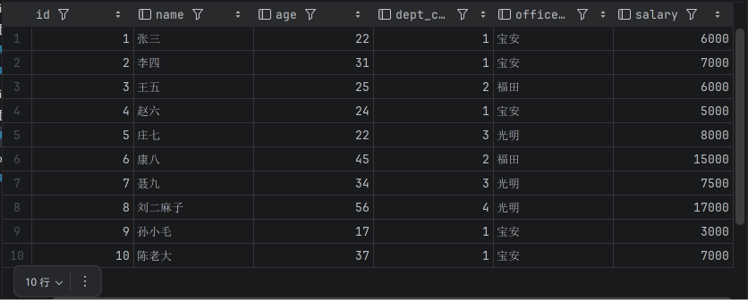

初始 emp 表包含 10 名员工，庄七和康八的工资分别为 8000 和 15000。

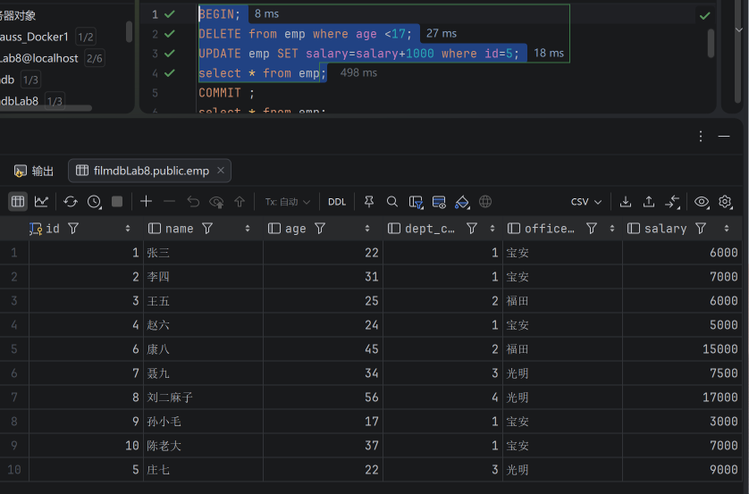

事务内庄七工资增加到 9000，age < 17 未匹配记录，因此仍有 10 人。

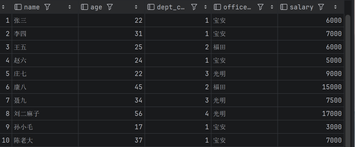

提交后再次查询，庄七工资仍为 9000。

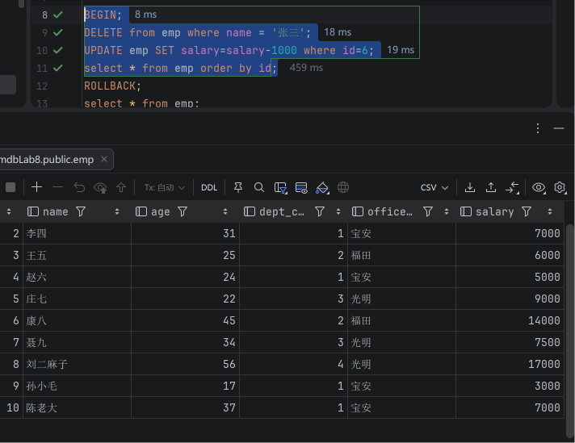

回滚前张三被删除，康八工资暂时降为 14000。

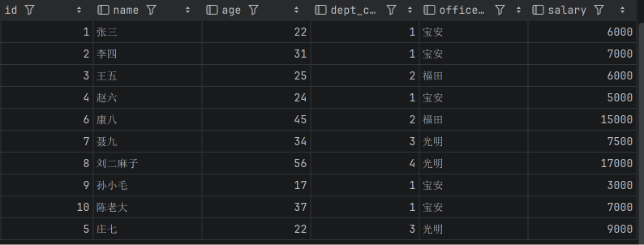

执行 ROLLBACK 后，张三恢复且康八工资恢复为 15000，上一事务的加薪保留。

## E2 一致性

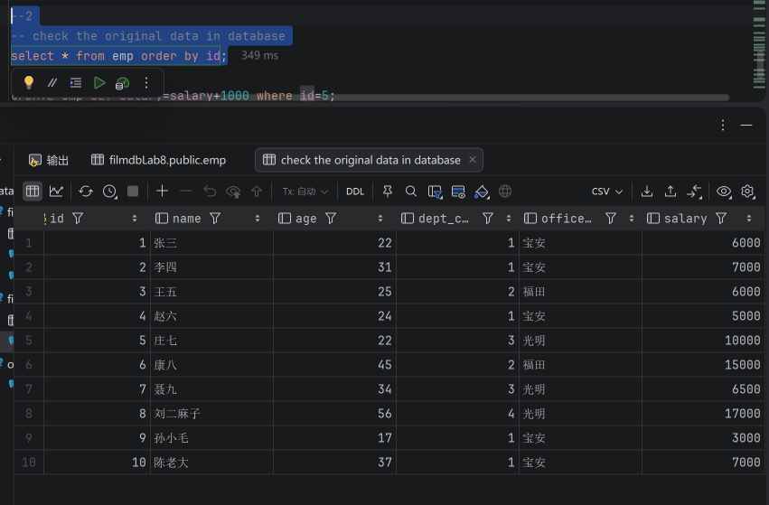

本组开始前，庄七、康八和聂九的工资分别为 10000、15000 和 6500。

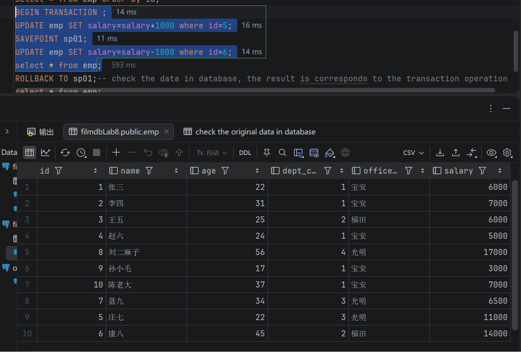

保存点前庄七加薪至 11000，保存点后康八减薪至 14000。

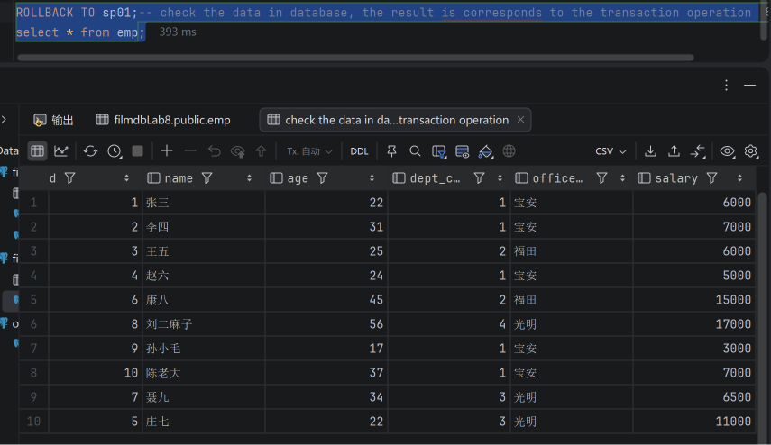

回滚到 sp01 后庄七的加薪保留，康八恢复为 15000，数据与保留的操作对应。

## E3 持久性

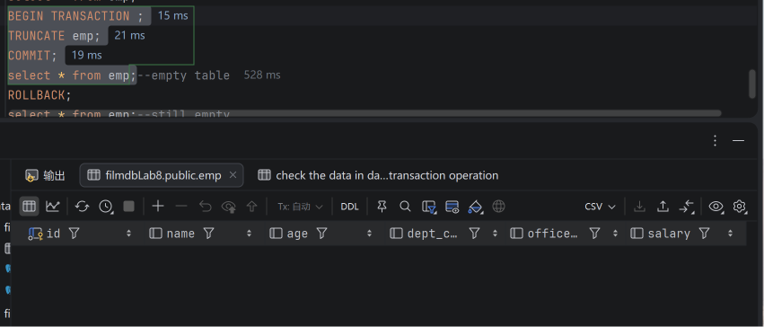

TRUNCATE emp 并 COMMIT 后，查询结果为空。

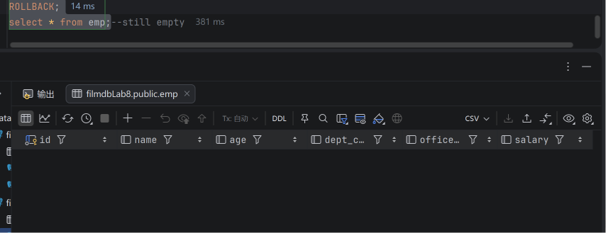

随后执行 ROLLBACK，表仍为空，已提交的清空操作不会被撤销。

## E4 读已提交

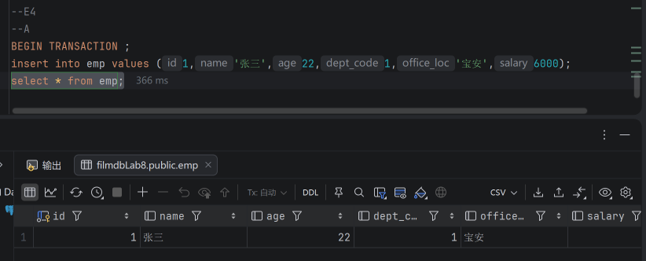

A 插入张三但尚未提交，A 可以看到自己的修改。

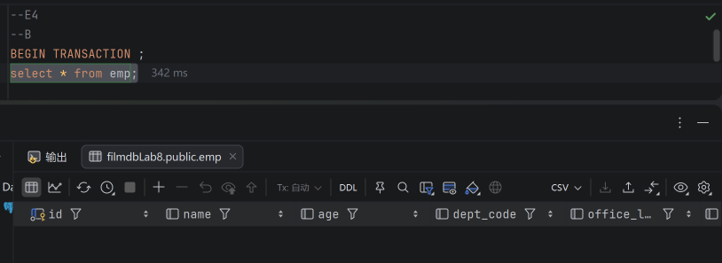

B 在事务内查询仍为空，无法读取 A 未提交的数据。

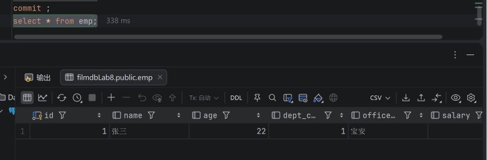

A 提交后查询，可以看到已保存的张三记录。

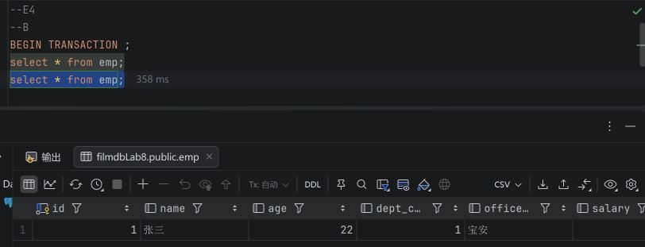

B 在原事务内再次查询，此时可以看到 A 刚提交的张三。

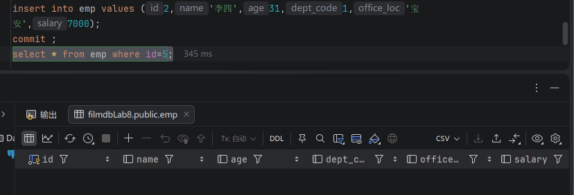

B 插入李四并提交后，按 id = 5 查询为空，因为该记录尚未插入。

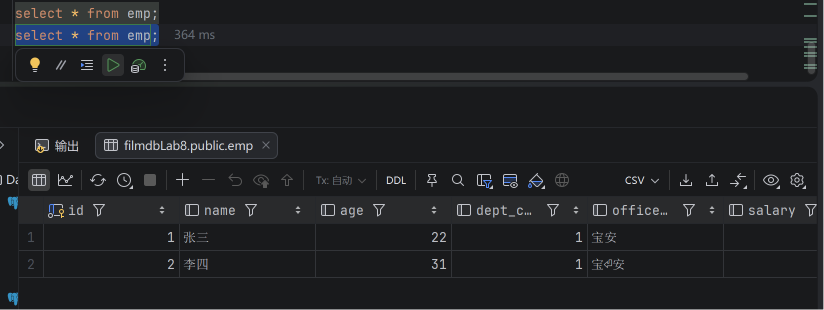

A 再次查询，可以看到张三和李四两条已提交记录。

## E5 可重复读

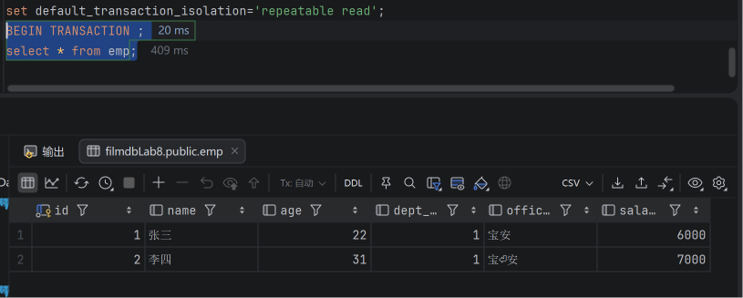

事务开始后查询得到张三、李四两条记录。

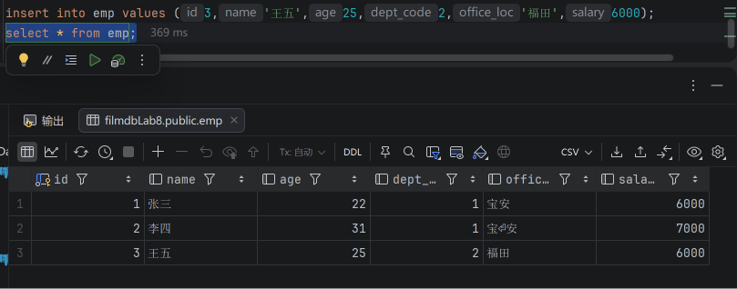

A 插入王五后，自己的查询结果增加到三条。

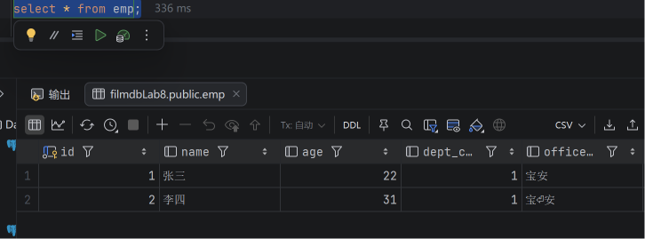

A 尚未提交时，B 仍只看到张三和李四。

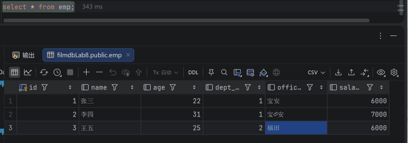

A 提交后查询，可以看到包含王五的三条记录。

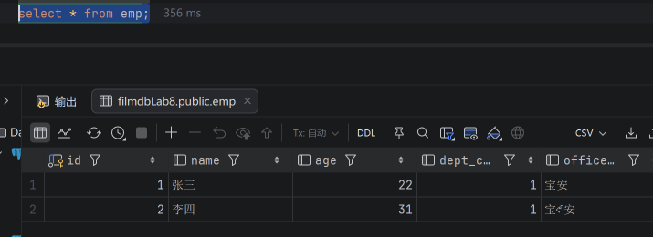

即使 A 已提交，B 在原事务中仍使用旧快照，只看到两条记录。

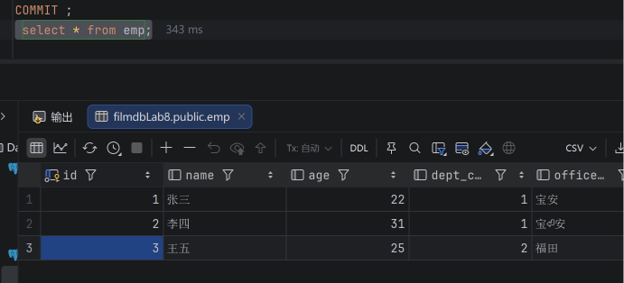

B 提交结束原事务后再次查询，才看到王五，共三条记录。

## E6 可串行化

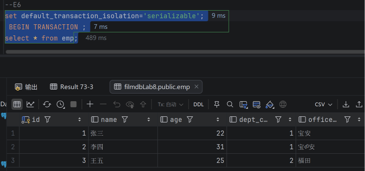

A 设置 serializable 并开始事务，首次查询得到前三条记录。

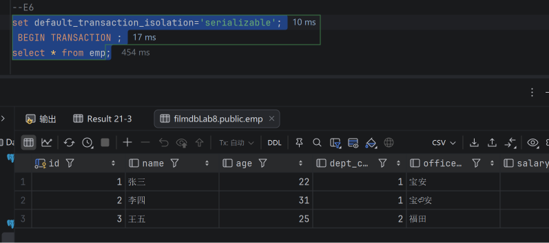

B 同样设置 serializable 并开始事务，也查询到前三条记录。

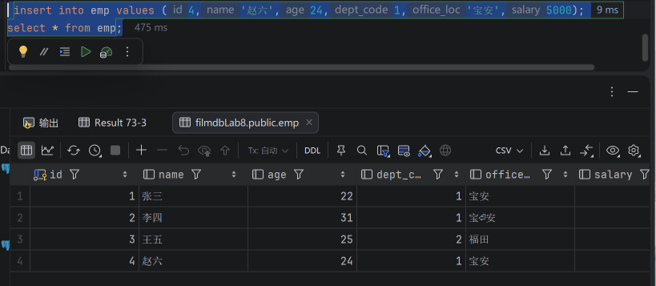

A 插入赵六但尚未提交，A 可以查询到四条记录。

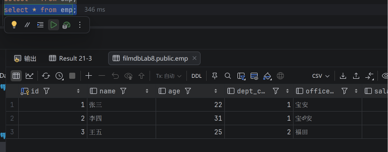

B 在原事务中查询仍只有三条记录，看不到 A 新增的赵六。

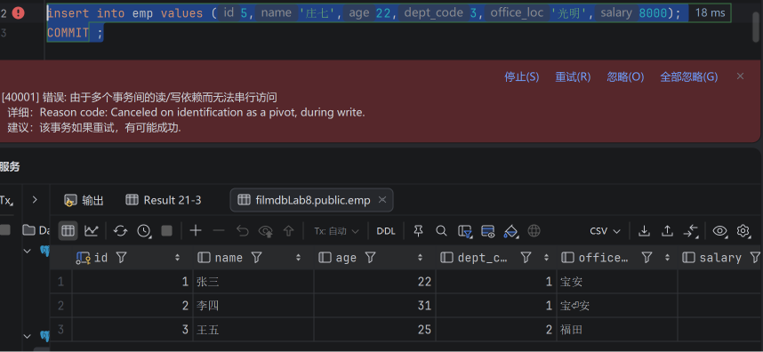

A 提交后，B 尝试插入庄七时出现 40001 序列化冲突，写入失败。
