# DBMS 性能评测实验报告

## 摘要

在同一台机器上，用 4 份真实数据（IMDb 1,285 万作品 / 3,000 万条参与记录、航班 1,393 万条 × 34 列、课程电影集 9,204 部、淘宝 500 万条 × 21 列）做了 12 组对比实验，把**原生文件程序**、**PostgreSQL 18.6**、**openGauss 5.0.0** 三者放在一起比较。

**主要发现**：
1. **数据库的优势不在单纯的速度，而在数据的维护与正确性。** 它的快靠索引、并行、列存这些机制，而机制文件也能自己实现；真正追不平的是数据库的索引建一次就自动同步、程序关掉还在、中断后自动回滚，而文件要每次重建、断开就失效、只剩残缺产物。
2. **按默认配置比 PostgreSQL 更好，各自调到最优时 openGauss 上限更高。** openGauss 默认关并行、没带 trigram，在扫描、连接、聚合、批量写入上落后 1.89–23 倍；但换上列存后聚合反超 10.7 倍、换上 Ustore 后膨胀减半。

---

## 目录

**1. 实验目标**

**2. 实验环境**

**3. 数据集**

**4. 具体实验**

*第一部分：重点对比*
　[4.1 E1 标题关键词检索](#41-e1-标题关键词检索)
　[4.2 E2 人名变长更新（T → Ttt）](#42-e2-人名变长更新t--ttt)
　[4.3 E2b 等长更新对照（T → X）](#43-e2b-等长更新对照t--x)
　[4.4 E3 主键点查](#44-e3-主键点查)
　[4.5 E4 多表连接 JOIN](#45-e4-多表连接-join)

*第二部分：补充实验*
　[4.6 E5 存储布局与索引机制](#46-e5-存储布局与索引机制)
　[4.7 E6 表膨胀与空间回收](#47-e6-表膨胀与空间回收)
　[4.8 E7 聚合统计](#48-e7-聚合统计)
　[4.9 E8 并发检索](#49-e8-并发检索)
　[4.10 E9 宽表聚合](#410-e9-宽表聚合)
　[4.11 E10 批量写入](#411-e10-批量写入与事务大小)
　[4.12 E11 中断写入](#412-e11-中断写入)

**5. 分析讨论**
　5.1 问题一：DBMS 相对文件操作的独特优势是什么
　5.2 问题二：PostgreSQL 与 openGauss 哪个更好，依据什么标准
　5.3 实验的局限
　5.4 启示

---

## 1 实验目标
回答两个问题：

1. **与在文件中操作数据相比，DBMS 的独特优势是什么？**
2. **哪个 DBMS 更好？PostgreSQL 还是 openGauss，依据什么标准？**

第 5 章分别作答。

---

## 2 实验环境

| 项目 | 配置 |
|---|---|
| 操作系统 | Windows 11 家庭中文版 25H2（Build 26200.9457） |
| PostgreSQL | 18.6，Windows 本机原生安装，端口 5432，`shared_buffers = 128 MB`，`work_mem = 4 MB`，`max_connections = 100` |
| openGauss | 5.0.0，Docker Desktop + WSL2 容器，宿主机端口 5433，`shared_buffers = 1 GB`，`work_mem = 64 MB`，`max_connections = 200`，`query_dop = 1`（另测 4） |
| JDK | 24.0.2 |
| JDBC 驱动 | PostgreSQL JDBC 42.2.5（openGauss 也走这个驱动，以 PostgreSQL 协议连接） |
| 客户端 | PowerShell 命令行 / `psql` 18.6 |
| 环境差异 | PostgreSQL 本机原生，openGauss 跑在 WSL2 + Docker 容器里 |

## 3 数据集

| 编号 | 数据集 | 领域 | 实测规模 | 用于 | 来源与许可 |
|---|---|---|---|---|---|
| 1 | 课程提供 filmdb | 电影 | 185 国家 / 9,204 电影 / 16,489 人 / 46,850 参与 / 3,365 别名 | 老师指定题的原始题库 | 课程提供 |
| 2 | IMDb 官方数据集 | 电影 | 12,849,219 作品 / 15,717,662 人 / 30,000,000 参与 / 150,353 中文译名 | E1–E8、E11 | `datasets.imdbws.com`（IMDb 非商业许可） |
| 3 | 美国 BTS 航班准点数据 | 民航 | 13,926,960 条 × 34 列（2023-01～2024-12） | E9 | `transtats.bts.gov`（美国政府公开数据） |
| 4 | 淘宝广告点击数据 | 电商 | 5,000,000 条 × 21 列 | 已导入，最终实验未使用 | HuggingFace `reczoo/TaobaoAd_x1`（学术研究用途） |

四份都是真实公开数据，同一份数据同时以 TSV 文件和两个数据库表三种形式存在。

本实验主要用课程提供电影相关数据。为了探索更大的数据对结果的影响，我从网上找来了下面三个数据。IMDb数据同样是电影领域的数据，表存的数据及其组合形式跟课程提供的数据区别不会很大，所以后面实验中探索更大量数据主要用的这个。
下面两个数据除了量大这一追求以外，更多的是增添有趣性，当然最后第4条在本实验中并未用到我也略感可惜。

## 4 具体实验

### 4.1 E1 标题关键词检索

#### 实验目的

探索项目文件中提出的第一个问题：在1,285 万条电影标题中查找含指定关键词的条目，"读取 CSV 文件"与"查询数据库"各需多久，差距来自哪里。

#### 实验方法

三组对照：

| 组 | 实现 | 做法 |
|---|---|---|
| 组 1 | Java 文件程序 | 逐行流式读取 TSV，对标题字段做 `String.contains` 判断，累计命中数 |
| 组 2 | PostgreSQL | `SELECT count(*) FROM imdb.movies WHERE title LIKE '%love%'` |
| 组 3 | openGauss | 同一句 SQL |

**关键词选择**：在这里我们使用 `love`来进行实验。
实验进行之前曾考察过数据，love在已有电影类数据中存在率大概为1%，不至于过低看不出结果，也不至于过高导致实验转为测试“扫描速度”，是较为合适的选择。

#### 正式实验

##### 组 1：文件程序
运行java -Xmx4g -cp . MovieBench file search love

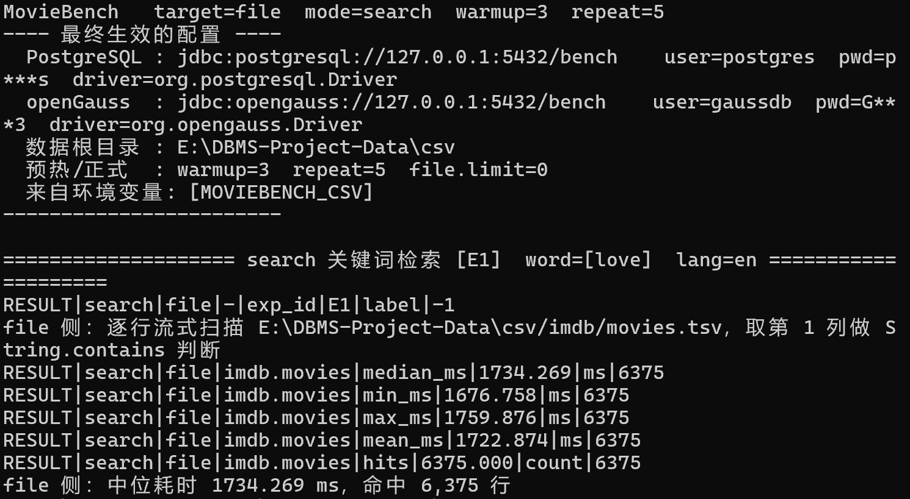

##### 组 2：PostgreSQL
运行java -Xmx4g -cp ".;postgresql-42.2.5.jar" MovieBench pg search love

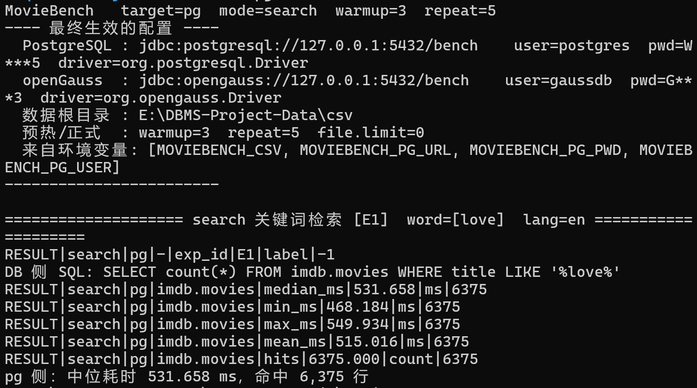

可以发现postgreSQL相对于文件快了3.26倍。但这里查询条件用不上索引，它同样要把几万行数据全部读一遍，拿每一行去跟love比一下，可以说跟文件做的事基本一模一样。
那么到底快在哪了？
我们先来跑一下第三组：

##### 组 3：openGauss
运行java -Xmx4g "-Dog.driver=org.postgresql.Driver" -cp ".;postgresql-42.2.5.jar" MovieBench og search love

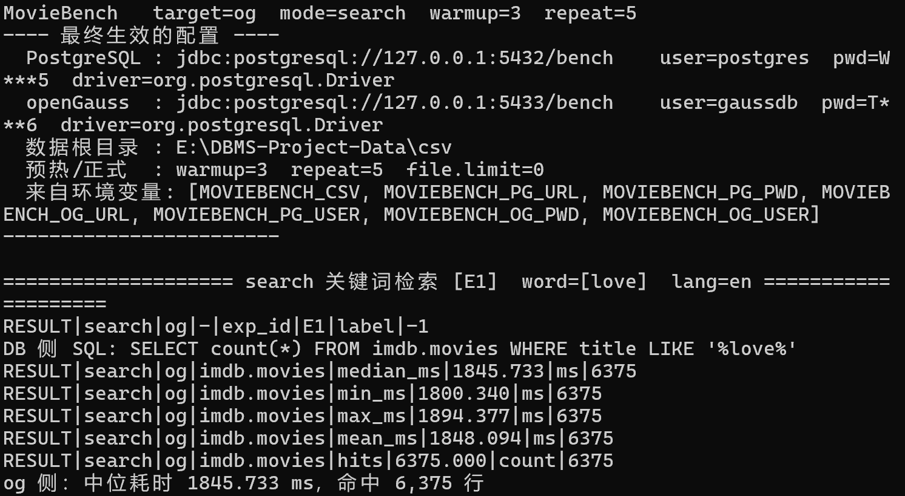

这一组在运行的时候相对于文件慢了6.4%。openGauss在这里输给了一个读文件的普通程序，这又是为什么？
我让ai整理了数据库内部的执行计划：

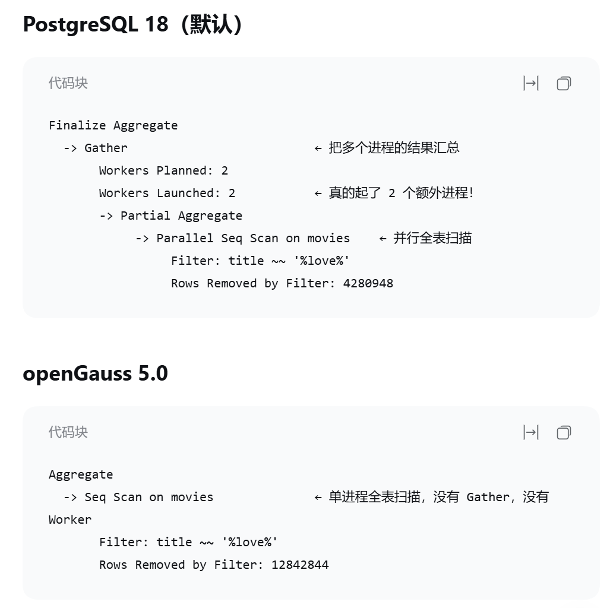

所以问题在哪就显现出来了：
PostgreSQL 18 看到表很大，自动把全表扫描拆给 3 个进程干；openGauss 我们设了query_dop = 1（不并行），一个人从头扫到尾。

下面我们将openGauss的并行开开再运行一次：

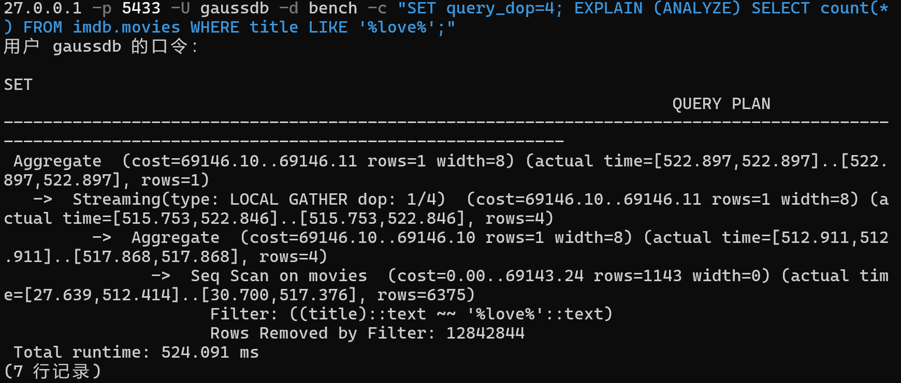

上图是单次运行的结果（524.091 ms），后面表 4-1-1 里报的是 5 次测量的中位数 482.512 ms。运行时间明显降低了。

同样地，把postgreSQL的并行关掉运行：

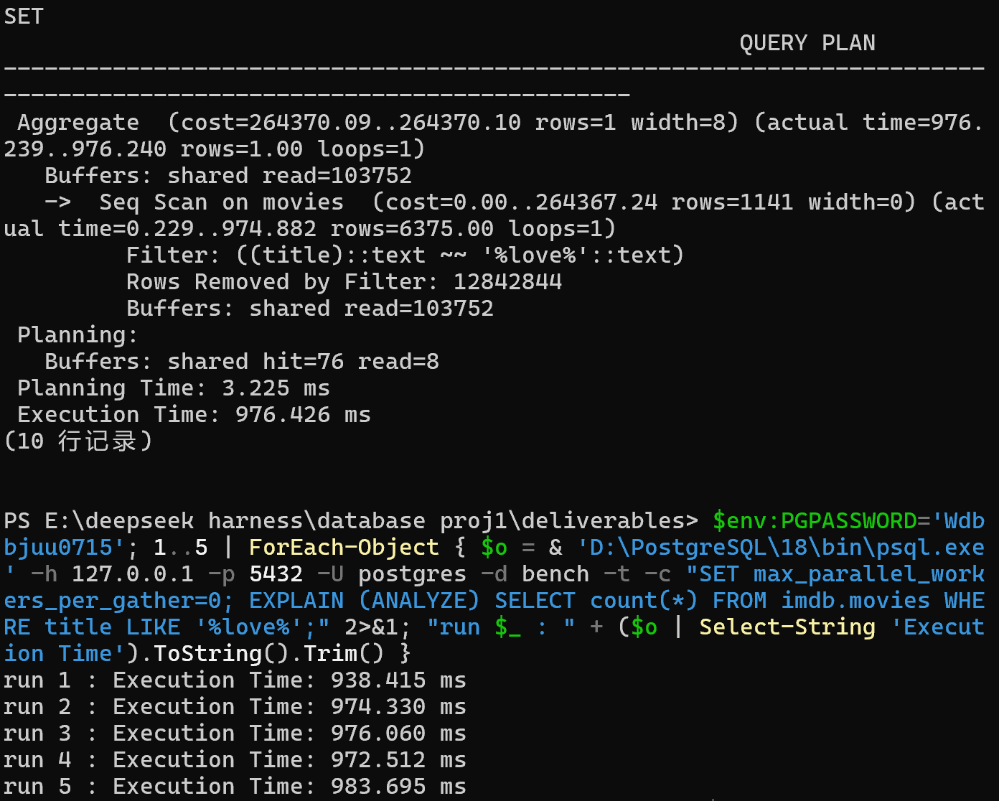

关掉并行后耗时升到约 974 ms 。看来 PostgreSQL 那 3.26 倍的优势里，有相当一部分是并行 worker 贡献的。

##### 结果统计

**表 4-1-1 标题检索耗时（数据 2，12,849,219 行，关键词 `love`，命中 6,375 行）**

| 被测对象 | 配置 | 中位耗时 (ms) | 最小 (ms) | 最大 (ms) | 相对文件 |
|---|---|---|---|---|---|
| 文件程序（Java 读 CSV） | 单线程 | **1,734.269** | 1,676.758 | 1,759.876 | 基准 1.00× |
| PostgreSQL 18.6 | 默认（3 进程并行） | **531.658** | 468.184 | 549.934 | 快 **3.26×** |
| PostgreSQL 18.6 | `max_parallel_workers_per_gather = 0`（单进程） | **974.330** | 938.415 | 983.695 | 快 **1.78×** |
| openGauss 5.0.0 | `query_dop = 1`（默认，单进程） | **1,845.733** | 1,800.340 | 1,894.377 | **慢 6.4%** |
| openGauss 5.0.0 | `query_dop = 4` | **482.512** | 443.516 | 605.322 | 快 **3.59×** |

##### 结果说明

**数据库在查询用不上索引、又没有并行时，可能比读文件还慢。两数据库的差距几乎全部来自“并行开关”。**
**并行的收益也不是两边一样大**：PostgreSQL 从 974.330 降到 531.658（**提速 1.83×**，用了 2 个 worker），openGauss 从 1,845.733 降到 482.512（**提速 3.83×**，`query_dop=4`）。openGauss 单进程慢，但并行扩展性更好，4 路并行把差距全部追了回来。

其次，缓存状态对测量结果存在影响。首次执行的时候，运行时间达到 944 ms，随后稳定在 500ms左右。第一次的 944 ms 是冷缓存（数据尚在磁盘）造成的。若不预热，测量结果会严重偏离。

##### 另外
我想知道中文对于检索情况会不会有影响，于是进行了以下实验：
在同一张中文译名表上分别用 ASCII 与中文关键词检索：

**表 4-1-2 中英文检索对照（imdb.alt_titles，150,353 行）**

| 关键词 | 字符类型 | 每字符字节数 | 命中数 | 文件 (ms) | PG (ms) | OG (ms) |
|---|---|---|---|---|---|---|
| `love` | ASCII | 1 | 67 | 35.595 | 11.983 | 18.917 |
| `爱` | 中文 UTF-8 | **3** | 1,402 | 28.404 | 13.268 | 19.236 |

中文检索**并没有变慢**。为排除"命中数不同"的干扰，又在 1,285 万行的英文电影表上做了一次对照——同一张表、同一批行，只换关键词：

**表 4-1-3 同一张表上不同字符集关键词的扫描耗时（imdb.movies，12,849,219 行）**

| 关键词 | 字符数 | 字节数 | 命中数 | 文件 (ms) | PG (ms) | OG (ms) |
|---|---|---|---|---|---|---|
| `love` | 4 | 4 | 6,375 | 1,817.535 | 598.761 | 1,651.599 |
| `爱` | 1 | **3** | 0 | 1,575.663 | 549.233 | 1,380.518 |

三个实现上中文关键词都略快 8–16%。差异来自**关键词长度**（4 字符 vs 1 字符，子串匹配的逐位比较次数不同）与**命中数**（6,375 vs 0），与字符在 UTF-8 中的字节宽度无关。

### 4.2 E2 人名变长更新（T → Ttt）

把**所有人名中的 `T` 替换成 `Ttt`**。
这里关键在于**记录会变长**：`Tom Tylor`（9 字符）→ `Tttom Tttylor`（13 字符），直接覆盖会踩到下一行，所以文件程序只能**把整个文件读完、改完、另写一个新文件**，这是本实验的核心对照点。

#### 实验方法

三组对照，针对同一份数据：

| 组 | 实现 | 做法 |
|---|---|---|
| 组 1 | Java 文件程序 | 读入 `imdb/people.tsv` → 逐行替换 → **写出一个新文件** |
| 组 2 | PostgreSQL | `UPDATE imdb.people SET first_name = replace(first_name,'T','Ttt'), surname = replace(surname,'T','Ttt') WHERE first_name LIKE '%T%' OR surname LIKE '%T%'` |
| 组 3 | openGauss | 同一句 SQL |

**数据重置**：`T → Ttt` 的替换，因为`Ttt` 里还含 `T`，重复执行会得到 `Ttttt`，所以每一轮测量前必须把数据恢复原状。重置本身代价很大：PostgreSQL 每轮约 100 秒，openGauss 每轮约 31 秒。这也是这一组实验总耗时接近 40 分钟的原因。
**重置耗时单独统计，不计入被测时间。**

#### 正式实验

组 1 运行 `java -Xmx4g -cp . MovieBench file update T Ttt`：

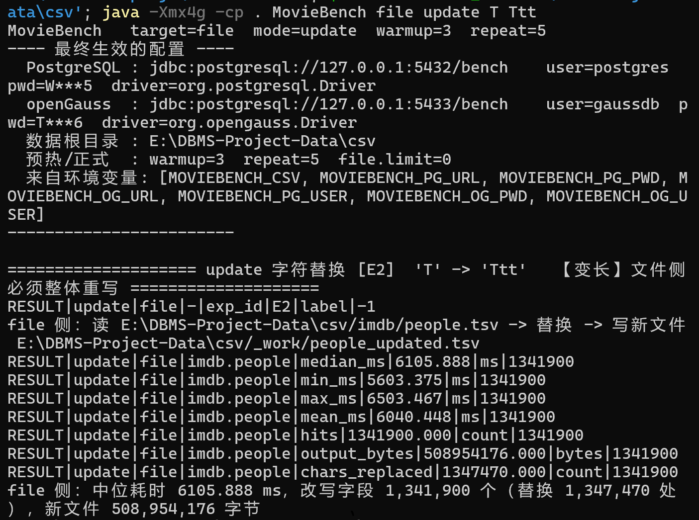

组 2、组 3 执行同一句 `UPDATE`，结果见下表。

#### 结果统计

**表 4-2-1 变长更新耗时（数据 2，`imdb.people` 15,717,662 行，其中 1,306,102 行含大写 `T`）**

| 被测对象 | 中位耗时 (ms) | 最小 (ms) | 最大 (ms) | 影响范围 | 相对文件 |
|---|---|---|---|---|---|
| 文件程序（整体重写） | **6,105.888** | 5,603.375 | 6,503.467 | 1,341,900 个字段 | 基准 1.00× |
| openGauss | **22,515.511** | 20,489.227 | 23,769.143 | 1,306,102 行 | 慢 **3.69×** |
| PostgreSQL | **41,054.052** | 39,377.799 | 42,566.923 | 1,306,102 行 | 慢 **6.72×** |

（两个"影响范围"数字不一样是正常的：数据库报的是**受影响行数**（1,306,102 行含 `T`），文件程序报的是**实际改动的字段数**（一行有 `first_name` 和 `surname` 两个字段，合计 1,341,900 个字段被改写）。语义一致。）

**表 4-2-2 文件部分**

| 项目 | 字节数 | 说明 |
|---|---|---|
| 读入（原文件） | 506,259,236 | 482.8 MB |
| 写出（新文件） | 508,954,176 | 485.4 MB |
| **总 I/O** | **1,015,213,412** | 968 MB |
| 数据本身 | 506,259,236 | 483 MB |
| **写放大倍数** | **2.00×** | 必须完整读一遍 + 完整写一遍 |

**表 4-2-3 更新在数据库里留下的副作用（PostgreSQL，单次 UPDATE）**

| 项目 | 数值 | 说明 |
|---|---|---|
| 表大小（更新前） | 928,301,056 字节（885 MB） | 重置后的干净状态 |
| 表大小（更新后） | 1,005,232,128 字节（959 MB） | — |
| **表体积增长** | **+73.4 MB（+8.29%）** | 130 万个新版本行，旧版本仍留在页里 |
| **WAL 日志增量** | **1,488,247,713 字节（1.39 GB）** | **相当于整张表大小的 1.60 倍** |
| 平均每行 WAL | 1,139 字节 | — |

ps：为什么改 130 万行会写掉那么多日志？
PostgreSQL 的 `full_page_writes` 默认开启。检查点之后，每个数据页的第一次修改都要把**整个 8 KB 页面**写进 WAL，用于防止磁盘部分写导致页面损坏。本次更新命中行散布在整张表中，几乎触及全部数据页（约 15 万个），因此产生了大量整页写入。这是数据库**可靠性**的代价，不是浪费。

##### 结果说明

**这一次文件程序赢了，而且赢得很多。** 一个逐行读 CSV 的 Java 程序比 PostgreSQL 快 6.72 倍（6,105.888 vs 41,054.052 ms）。

**原因在于两者干活的方式根本不同。** 文件程序**无条件重写每一行**，顺序读 483 MB、写 485 MB，不做任何判断；数据库要先**扫全表 1,571 万行**评估，再为命中的 130 万行写新版本行与 WAL 日志。**当命中行占比达到 8.3% 时**（此数据为ai统计），**这些开销加起来超过了"整体重写"**，即"笨办法"打败了"聪明办法"。反过来：命中率很低时，"先筛再改"才会显出优势。

另外：这次 openGauss 反超 PostgreSQL **1.82 倍**，与 E1 的方向相反，说明两者强弱依赖工作负载类型。

### 4.3 E2b 等长更新对照（T → X）

E2里的慢，有两种可能：
**(a)** 要写的数据量本来就大；
**(b)** 记录变长了，没法原地覆盖，只能整体重写。

所以我们这一次把 `T` 换成**同样长度的** `X`：
长度不变，就能直接在文件的对应字节位置上改，不必新建文件。

#### 实验方法

跟E2做同一件事，只是把替换目标从 `Ttt` 换成 `X`：

另外，一开始用 `RandomAccessFile.readLine()` 逐字节读取，483 MB 会产生约 5 亿次系统调用，跑了十分钟还没有结束，一直卡着不动。后来换成内存映射后时间陡然下降。也就是说，同一件事、同一个"原地覆写"的思路，只是换了方法，差了三个数量级。这说明在文件系统上做原地更新，**实现方式的选择比机制本身影响更大。**

#### 正式实验

运行 `java -Xmx4g -cp . MovieBench file update T X`

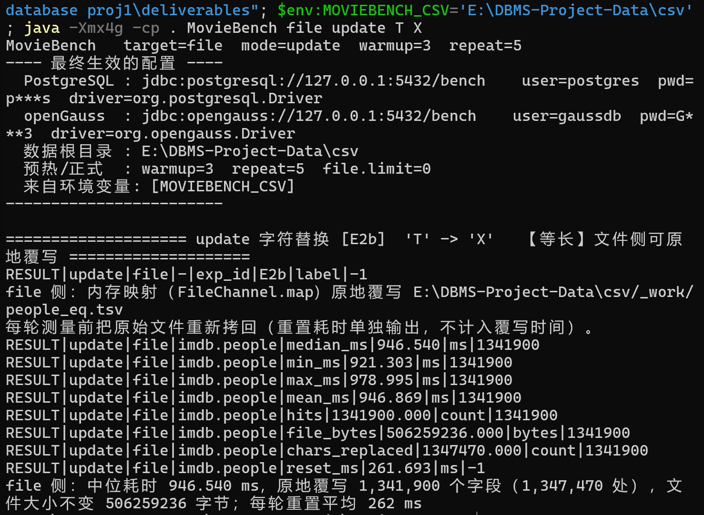

程序没有新建文件，而是打开 `people_eq.tsv` 直接改字节。跑完后：

- **中位耗时 946.540 ms**
- 改写 1,341,900 个字段，替换 1,347,470 处
- **文件大小 506,259,236 字节，一字节没变**
两次改写的字段数（1,341,900）和替换处数（1,347,470）一致，说明两组做的是同一件事，可以直接比较。

#### 结果统计

**表 4-3-1 变长与等长更新的代价对照（`imdb.people`，15,717,662 行）**

| 谁做的 | 变长 `T`→`Ttt` (ms) | 等长 `T`→`X` (ms) | 差值 (ms) | 变长代价倍数 |
|---|---|---|---|---|
| **文件程序** | **6,105.888** | **946.540** | **5,159.348** | **等长快 6.45×** |
| PostgreSQL | 41,054.052 | 39,613.033 | 1,441.019 | 等长快 1.04× |
| openGauss | 22,515.511 | 26,451.237 | −3,935.726 | 等长慢 1.17× |

#### 结果说明

**"记录变长"这一个变量，在文件系统上值 5,159 ms；在数据库上几乎一文不值。**

文件程序两次做的是同一件事、改的是同一批字段，唯一区别在于是不是等长变换，耗时差了 **6.45 倍**，这个差距完全来自"能不能原地改"。这就是文件修改数据收的税，躲不掉：只要记录长度会变，文件就必须整体重写。

数据库那边是另一回事：PostgreSQL 两种情形只差 **3.5%**、openGauss 差 **17.5%**，都落在测量波动范围内。因为数据库的 `UPDATE` 本来就不在原位置改（写新版本行，而这一行本身就是变长的），多几个字节、少几个字节对它没有结构性影响；文件却是一条连续字节流，记录一变长，后面所有字节都得往后挪。

**所以 E2 和 E2b 揭出的是两个不同的点**：E2 里数据库输在**找**上，E2b 暴露出文件系统在**改**上还有一个固有弱点——两个弱点互补，缺一个都解释不清这组对比。

---

### 4.4 E3 主键点查

E1 和 E2 的查询条件都用不上数据库已有的主键索引（都是 `%...%` 中间匹配），结果是数据库赢 E1、输 E2，很不稳定。
按主键查一条记录是最纯粹的定位场景：文件必须一行行找，数据库有主键索引可以直接跳过去。
这一组想量化**索引到底值多少**。

#### 实验方法

| 实现 | 做法 | 需要预处理吗 |
|---|---|---|
| 文件·顺序扫描 | 每次查询都从文件头逐行读到命中为止 | 不需要 |
| 文件·内存哈希表 | 先把 1,285 万条全部读进内存建成 `HashMap<movieid,title>`，再查 | 建表 |
| 文件·排序 + 二分 + `seek` | 扫描一遍记录 `(movieid, 行偏移)`，排序后二分定位，再用 `RandomAccessFile.seek()` 读出那一行 | 扫描 + 排序 |
| PostgreSQL | `SELECT title FROM imdb.movies WHERE movieid = 1234567` | **不需要** |
| openGauss | 同上 | **不需要** |

这是这一组要说明的核心：数据库的索引不需要使用者操心，一直在那儿；而文件程序要做到同等速度，必须在**每次启动时自己重建**一份索引。

#### 正式实验

运行 `java -Xmx6g -cp . MovieBench file point 1234567`。

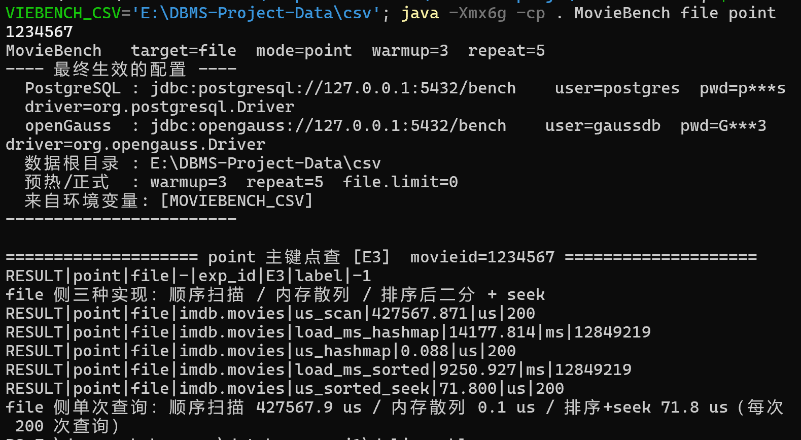

上图是文件侧的输出，我们可以看见这个数据很有意思：

- 顺序扫描 427,567.9 μs：每次查询都要把文件翻到 40% 处才命中
- 内存哈希表 0.088 μs：最快，但建表花了 14,177.8 ms
- 排序 + 二分 + `seek` 71.8 μs：建索引花 9,250.9 ms

数据库两侧用 JDBC 客户端实测，结果见下表。

#### 结果统计

**表 4-4-1 单次主键查询延迟与预处理代价（`imdb.movies`，12,849,219 行）**

| 实现 | 单次查询 (μs) | 预处理耗时 (ms) | 相对最快 |
|---|---|---|---|
| 文件·内存哈希表 | 0.088 | 14,177.814 | 基准 1× |
| 文件·排序 + 二分 + `seek` | 71.800 | 9,250.927 | 816× |
| **PostgreSQL（主键索引）** | 254.400 | **0（索引一直存在）** | 2,891× |
| **openGauss（主键索引）** | 1,037.000 | **0（索引一直存在）** | 11,784× |
| 文件·顺序扫描 | 427,567.871 | 0（无需预处理） | 4,858,726× |

#### 结果说明

**单次查询：文件的手工索引远快于数据库的索引（0.088 μs vs 254.400 μs）。但文件那份索引是"现建的"，数据库的是"一直在的"**。文件程序一退出索引就失效、下次得重建，数据库的主键索引建表时一次建好，预处理耗时为 0。

### 4.5 E4 多表连接 JOIN

前三组测的都是单张表。但数据库相对文件很大一个差别，其实在于**关系**：文件里只有一个"文件"，数据库里有多张表，还能用一句 SQL 把它们连起来。

#### 正式实验

统计每位导演执导的电影数并取前 20 名，同时用到 `movies` / `credits` / `people` 三张表。

| 实现 | 做法 | 预处理 |
|---|---|---|
| 文件·手写散列连接 | `movies` 装进位图、`people` 建成散列表，再扫描 `credits` 逐行查表 | **要**（8,670 ms） |
| PostgreSQL / openGauss | 一句 SQL，由优化器自行选择连接算法 | 不需要 |

有一点要注意：文件侧没做"2015 年以后"的年份过滤，数据库侧做了全部（过滤 + 分组 + 排序 + 取前 20）。文件干的活更少，结果要考虑这一点。

运行结果：
文件：

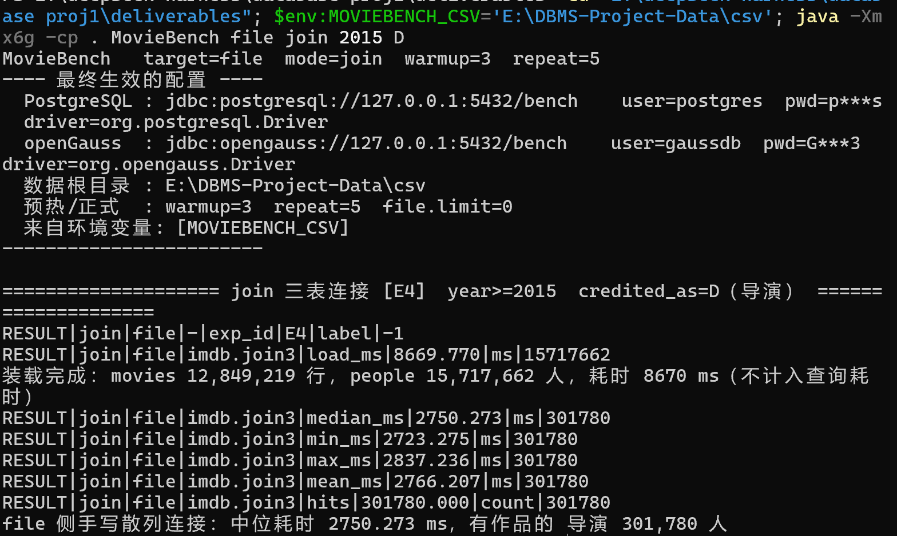

postgreSQL：

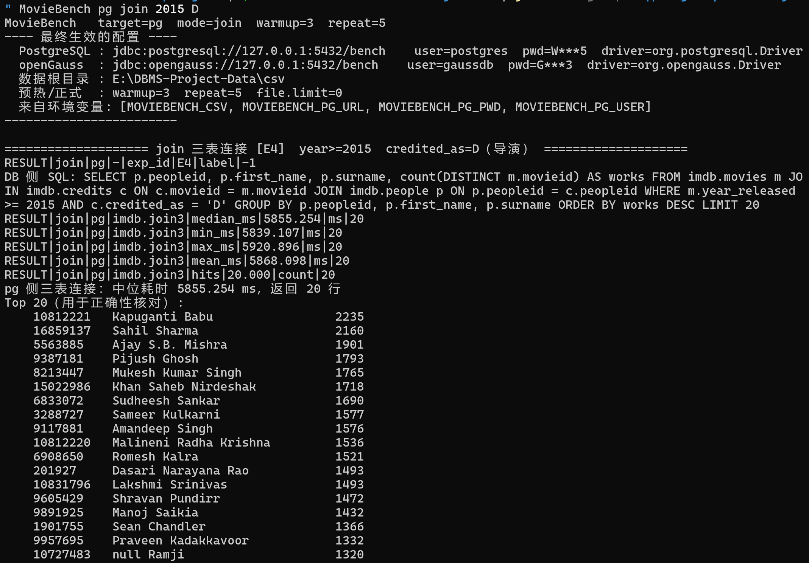

openGauss：

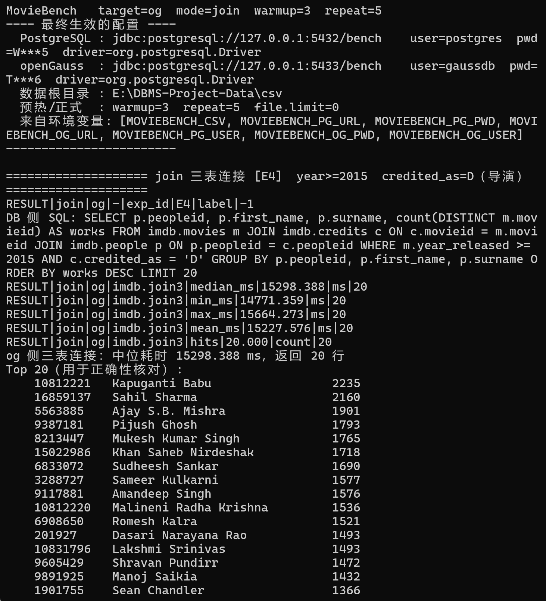

#### 结果统计

**表 4-5-1 耗时**

| 实现 | 连接耗时 (ms) | 装载 (ms) | **合计 (ms)** |
|---|---|---|---|
| 文件 | 2,750.273 | 8,669.770 | 11,420.043 |
| PostgreSQL | 5,855.254 | **0** | **5,855.254** |
| openGauss | 15,298.388 | **0** | 15,298.388 |

#### 结果说明

结果又是openGauss慢了许多，下图是运行的查询，依旧问题在并行上，把openGauss的并行开开重新运行，快了快4倍。

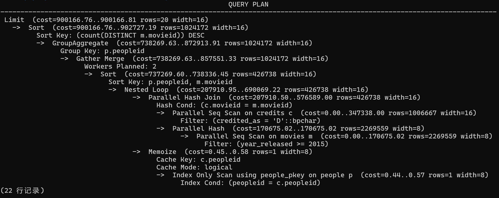

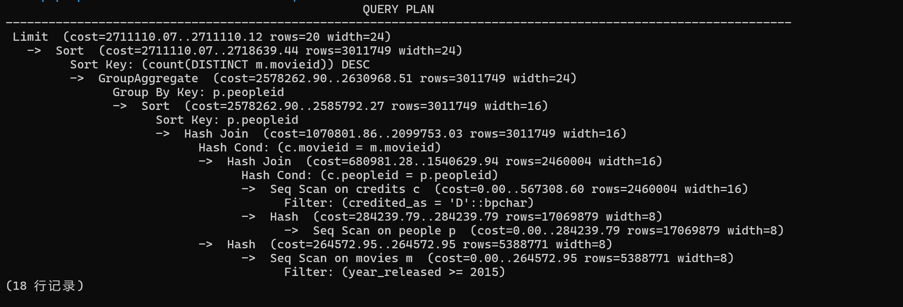

只看"连接"这一步，文件最快，但它干的活更少，这个"快"不能直接得出结论。**算上装载，PostgreSQL 反超近 2 倍。**

> E1–E4 做下来还不能完全看出数据库好不好、好在哪，只知道不同场景下三种方式各有优点。还不知道：数据库的优势来自哪里、文件方案到底行不行、openGauss 什么情况下会翻盘、数据库有什么代价。
> 于是又设计了后面几组实验。为了不让文档过于冗长，后面只写运行结果和结论。

---

### 4.6 E5 存储布局与索引机制

(ps:本节是全章最后执行的一组实验。E1–E4 和 E6–E11 全部是在建索引之前测完的)

项目提示第 4 条说"可以把数据重组成不同格式以获得更快的检索"。**快慢未必是介质决定的，也可能是组织方式决定的**。所以把同一份数据换成不同布局，看"怎么存"能换来多少速度。

**表 4-6-1 各种存储形态的检索代价（`imdb.movies` 12,849,219 行，关键词 `love`）**

| 实现 | 构建耗时 | 占用空间 | 检索耗时 (ms) | 相对同类基线 |
|---|---|---|---|---|
| 文件·普通 TSV | 0 | 494 MB | 1,723.568 | 1.00× |
| 文件·定长二进制 256 字节/条 | 5.3 s | 3,137 MB | 43,883.769 | **慢 25.5×** |
| 文件·内存映射 mmap | 0 | 494 MB | 2,127.872 | 慢 1.23× |
| **文件·反转索引** | 16.6 s | **363 MB** | **0.625** | **快 2,757×** |
| PG 顺序扫描 | 0 | — | 567.652 | 1.00× |
| PG trigram GIN | 92.5 s | 430 MB | 370.405 | 快 1.53× |
| PG 反转索引表 | 170.5 s | 2,279 MB | 399.273 | 快 1.42× |
| PG 反转索引表 + 回表 | — | — | 1,320.919 | **慢 2.33×** |
| OG 顺序扫描 | 0 | — | 1,794.107 | 1.00× |
| OG 反转索引表 | 79.9 s | 3,056 MB | 206.156 | 快 8.70× |
| OG 反转索引表 + 回表 | — | — | 8,684.002 | **慢 4.84×** |

**结论**
1. **这一局文件赢了数据库**
2. **反转索引"找词"快、"回表"崩**：查词本身快，但一旦回去取数据就慢了。
3. "重组数据格式"确实能带来数量级的提升，但这个提升不专属于数据库。文件侧只要把数据组织对了，反而能赢数据库很多倍。**让数据的物理组织和查询的形状匹配**
4. 这一组 openGauss 并非全输：纯词查询它反而比 PostgreSQL 快（206.156 vs 399.273 ms）；输的是回表（8,684.002 vs 1,320.919 ms，慢 6.6 倍）。

### 4.7 E6 表膨胀与空间回收

E2 里 PostgreSQL 改完 130 万行后表体积涨了8.29%，是MVCC 留下的死元组（旧版本行仍占着页面）。改一轮涨 8%，改十轮会怎样？

**表 4-7-1 表体积随更新轮次的变化（`imdb.people` 15,717,662 行，每轮 UPDATE 影响 1,306,102 行，中间不重置）**

| 轮次 | PG 表体 | PG 含索引 | OG·heap 表体 | OG·heap 含索引 | OG·Ustore 表体 |
|---|---|---|---|---|---|
| 0 | 815.1 | — | 816.7 | — | 733 |
| 1 | 885.3 | 1,352.7 | 887.0 | 1,379.8 | 759 |
| 5 | 1,192.7 | 1,666.8 | 1,196.5 | 1,836.5 | 1,010 |
| 10 | 1,578.1 | 2,086.0 | 1,642.3 | 2,282.6 | 1,085 |
| 涨幅 | **+93.6%** | — | **+101.1%** | — | **+48.0%** |
| `VACUUM FULL` 后 | **841.6** | **1,178.3** | **934.8** | **1,300.4** | — |
| `VACUUM FULL` 耗时 | 23,668 ms | — | 16,021 ms | — | — |

**结论**
1. **两个库的 heap 表都涨了约一倍**（+93.6% / +101.1%），全是等回收的死元组。**在这件事上两者没有差别。**
2. **但 openGauss 换 Ustore 引擎后涨幅只有 48%**，原因是 Ustore 做**原位更新**，不产生那么多旧版本行。
3. 数据库的更新不免费，改数据省了时间，空间和维护成本高。文件是"一次性付清"，数据库是"分期付款，还带利息"。

### 4.8 E7 聚合统计

E1 和 E4 都在"找行"，这一组方向相反——**不找具体行，而是把整张表压成几十个数字**。前者要返回明细，后者只需要一个汇总。数据库有专门的 `GROUP BY` ，文件侧只能手工维护一个 `HashMap` 累加。换一种负载类型，结论会不会变？

**表 4-8-1 按年份统计电影数量**

| 谁做的 | 中位耗时 (ms) | 最小 | 最大 | 分组数 |
|---|---|---|---|---|
| 文件程序 | 1,798.554 | 1,776.638 | 1,829.283 | 154 |
| **PostgreSQL** | **690.530** | 607.160 | 782.974 | 155 |
| openGauss | 1,827.541 | 1,811.486 | 2,131.946 | 155 |

**结论**
1. **PostgreSQL 快文件 2.60 倍**；openGauss 比文件慢 1.6%。
2. 换一种负载类型并没有改变结论。原因是**瓶颈在"扫描"而不在"聚合"**：两边都得把 1,285 万行读完，而分组只有 155 个、哈希表小得可怜，**聚合本身几乎不花时间**。PostgreSQL 那 2.60 倍的优势，几乎全部来自并行扫描。
3. 这一组的"聚合算子"其实没机会发挥。E5 已经证明索引对这类全表操作帮不上忙，要看出聚合算子的差别，得换列存——这一条后来在 E9 补做了（见 4.10）。

### 4.9 E8 并发检索

前面几组都是"一个人用"。但数据库和文件最现实的差别之一，是**很多人同时用**。文件是操作系统里的一个对象，多个进程同时读写它时"会读到什么"并没有定义；数据库则有 MVCC 快照机制来保证一致性。这一组想让多个线程同时做 E1 的检索，看谁先撑不住。

（数据：`imdb.movies`，12,849,219 行，关键词 `love`；每个并发度跑 10 秒）

**表 4-9-1 并发检索**

| 并发线程数 | 文件·平均 | 文件·P95 | PG·平均 | PG·P95 | OG·平均 | OG·P95 |
|---|---|---|---|---|---|---|
| 8 | 3,888 | 7,751 | 3,356 | 6,390 | **2,053** | **2,743** |
| 32 | **101,053** | **181,630** | 7,671 | 10,230 | **6,086** | **7,028** |
| 128 | 47,740 | 50,959 | 16,437 | 31,882 | **11,868** | **16,299** |

> PG = PostgreSQL，OG = openGauss。单位均为 ms。

（P95是那个95%比他快的那个请求，这样减少了少数极慢请求的影响，同时也增加平均值的信息含量）

**结论**
1. **文件侧最不稳**：P95几乎是其平均的两倍，说明相当一部分请求被卡住了。
2. **openGauss 在这一组反而全程领先**——三个并发度下它的平均延迟和 P95 都是最低的。openGauss 在"并发"这个维度上稳定占优（列存与 Ustore 是后来在 E9、E6 才补上的）。

### 4.10 E9 宽表聚合

E7 聚合的电影表只有 5 列。而真实的分析场景往往面对宽表：字段很多，每次却只用得上其中几列。这一组换成航班数据，想验证一个想法：**行式存储在宽表聚合上是不是天生吃亏？** 因为数据按行存放时，为了读一列，必须把整行都搬进内存。这也是 openGauss 提供**列存表**的原因，是它相对 PostgreSQL 最有可能翻盘的地方。

**表 4-10-1 航班数据聚合（`flights.flights`，13,926,960 行 × 34 列，按航空公司分组）**

| 谁做的 | 存储形态 | 中位耗时 (ms) | 最小 | 最大 | 分组数 |
|---|---|---|---|---|---|
| 文件程序 | — | 5,868.520 | 5,826.245 | 6,183.118 | 15 |
| PostgreSQL | 行存 | 1,785.041 | 1,735.935 | 1,840.592 | 15 |
| openGauss | 行存 | 6,864.947 | 6,812.451 | 6,957.841 | 15 |
| **openGauss** | **列存** | **476.767** | 473.517 | 494.551 | 15 |
| **openGauss** | **列存 + dop=4** | **166.090** | 160.077 | 169.115 | 15 |

**结论**
1. 行存配置下：PostgreSQL 快文件 3.29 倍，openGauss 比文件慢 17%。
2. **换列存后 openGauss 全场第一**：列存 **476.767 ms**，比自家行存快 **14.4 倍**、比 PostgreSQL 快 **3.7 倍**、比文件程序快 **12.3 倍**；再开 `dop=4` 到 **166.090 ms**，分别快 **41.3 / 10.7 / 35.3 倍**。（原因是只读两列：计划里行存 `Buffers: shared read=318285`，列存 `shared hit=883`，少读 360 倍）
3. 这一组推翻了"openGauss 一直输给文件程序"的说法。

### 4.11 E10 批量写入与事务大小

前面测的都是"怎么读"和"怎么改"，这一组换到**纯写入**。写数据时有个绕不开的成本：**每提交一次就要把日志刷一次**。刷盘是机械动作（或者系统调用），和数据量无关。所以直觉上，一次写 1 条和一次写 10,000 条，单条的固定开销能差出几十倍。

**表 4-11-1 不同批量大小下的写入（单位 行/秒）**

| 批量大小 | 文件 | PostgreSQL | openGauss |
|---|---|---|---|
| 1 | 475 | **3,611** | 156 |
| 100 | 46,752 | **159,164** | 12,622 |
| 1,000 | **391,811** | 249,368 | 31,472 |
| 10,000 | **1,983,336** | 257,886 | 35,392 |

**结论**
1. **批量从 1 提到 100，三方都出现数量级跃升**
2. 拐点出现在批量为 1,000 附近：PostgreSQL 从 159K 涨到 249K 后就基本封顶（10,000 时只到 258K）；文件则继续猛涨到 198 万。数据库的每批开销里包含维护索引等固定成本，批量再大也摊不薄。批量足够大时，文件程序反超两个数据库。
3. **openGauss 在所有批量下都明显落后于 PostgreSQL**，输的彻底。

### 4.12 E11 中断写入

前面所有实验都在"程序正常跑完"的前提下比速度。但真实系统里程序随时可能被中断：断电、崩溃、误操作...**这个时候数据会变成什么样？** 文件和数据库给出的答案完全不同。这一组把两边都做到一半，然后看看结果。

（ps：强杀的是客户端 Java 进程，不是数据库服务进程。数据库本身不受任何影响。）

**表 4-12-1 强制中断后的数据状态**

| 场景 | 中断时的进度 | 中断后的状态 | 数据是否一致 |
|---|---|---|---|
| 文件侧（重写 TSV） | 写到源文件约 30% | 产物 `people_killed_halfway.tsv` 只有 137,031,593 字节，而完整文件应为 506,259,236 字节——**只剩 27%** | 残缺，不可用 |
| PostgreSQL（事务未提交） | `UPDATE` 已执行完、尚未 `COMMIT` | 含 `Ttt` 的行数：中断前 **3 行** → 中断后 **仍是 3 行** | **完全回滚** |
| openGauss（事务未提交） | 同上 | 含 `Ttt` 的行数：**3 行 → 3 行** | **完全回滚** |

**结论**
1. 文件侧被强杀后，产物是一个残缺品，直接打开会解析失败。
2. **数据库的未提交事务被自动撤销。** 两个数据库表现一致：**中断前后数据一字未变**。这是数据库在检测到客户端连接断开时**自己执行了回滚**。
3. 这是事务的"原子性"：一个事务要么全做，要么全不做，不存在"做了一半"的中间状态。**文件系统不具备这个性质。**文件侧想获得同等级别的保证，需要自己搭一整套机制。

---

## 5 分析讨论

### 5.1 问题一：DBMS 相对文件操作的独特优势是什么

**数据库的优势在于数据的维护与正确性，也就是当"出事"或多人同时用时，数据能不能保持在一个合法的状态，以及数据更新的时效性与方法的保留。**

- 先讨论速度这一层。数据库在多数场景下确实更快：E3 点查比文件的顺序扫描快 1,681 倍、E9 列存聚合比文件快 35.3 倍、E1 开并行后比文件快 3.26 倍。但这些快都来自具体的机制（索引、并行、列存），而机制本身并不是数据库独有的：E5 里文件手工建的反转索引只用 363 MB / 0.625 ms，反超 PostgreSQL（2,279 MB / 399.273 ms）和 openGauss（3,056 MB / 206.156 ms）330–640 倍。文件落后于数据库的地方，多数是没有实现，而不是实现不了。
- 维护方面。E3 里数据库的主键索引预处理耗时为 0，之后对数据的每一次增删改都会自动同步，查到的永远是最新状态，程序关掉它还在；文件那份哈希表要现场建 14.177 秒，程序一退出就没了，基础数据一改也作废。
- 正确性方面。E11 里强杀客户端后数据库自动回滚、数据一字未变，文件只留下一个 27% 的残缺文件；E2b 里文件侧"变长"比"等长"慢 6.45 倍，数据库侧两者无差别——因为数据库的 UPDATE 本来就不在原位置改，记录变长对它不构成问题。

### 5.2 问题二：PostgreSQL 与 openGauss 哪个更好

**按默认配置比 PostgreSQL 更好，各自调到最优时 openGauss 上限更高。**

- 先说赢面。PostgreSQL 赢在"面"，扫描（E1 快 1.89 倍）、连接（E4 快 2.61 倍）、聚合（E9 快 3.85 倍）、批量写入（E10 快 7–23 倍）这些常见负载它都领先。openGauss 赢在"点"，赢的四场都很具体：用列存做分析型聚合（E9 只要 166.090 ms，比 PostgreSQL 快 10.7 倍、比自家行存快 41.3 倍）、用 Ustore 抗更新膨胀（E6 从 +101% 降到 +48%）、用线程模型扛高并发（E8 三个档位 P95 都最低）、以及纯更新本身（E2 快 1.5–1.8 倍）。
- 成因。openGauss 默认配置下全面落后，不是引擎差，是它默认把并行关掉了（`query_dop=1`）、也没带 trigram 扩展；E1 实测把 `query_dop` 调到 4，它就快 3.83 倍，直接反超。而它真正的上限来自换存储形态。列存和 Ustore 是 PostgreSQL 没有的东西，PostgreSQL 只有行存一条路。
- 代价方面。PostgreSQL 的赢是"打开就能用"，默认开并行、自带 trigram，使用者不需要做任何决定；openGauss 要求先判断负载、再选引擎（行存还是列存、Astore 还是 Ustore），选错了就退回上面那种落后的状态。

### 5.3 实验的局限

实验存在诸多局限和不足，越往下探究越觉得扑朔迷离，可谓有“做的越多，做的越少”之感。

需要一提的一个局限是 PostgreSQL 本机原生，openGauss 跑在 Docker 容器里，存在一定的差别，可能会对上面的实验造成一定影响。

### 5.4 启示

| 场景 | 该用什么 |
|---|---|
| 高选择性查询（点查、精确匹配） | 数据库：索引白送，预处理为 0（E3） |
| 全表扫描 / 低选择性查询 | 别指望索引，看并行配置（E1、E5） |
| 需要原子性、并发一致性 | 只能数据库（E11、E8） |
| 分析型聚合、宽表 | 列存（E9：比自家行存快 14–41 倍） |
| 更新频繁、空间紧张 | Ustore（E6：膨胀减半） |
| 只读、访问模式固定、追求极致性能 | 文件手工布局，但要自己维护（E5） |

*报告完*
